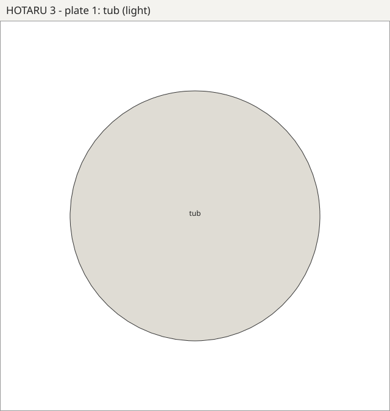
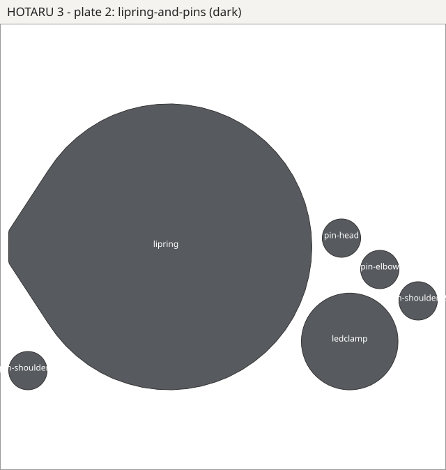
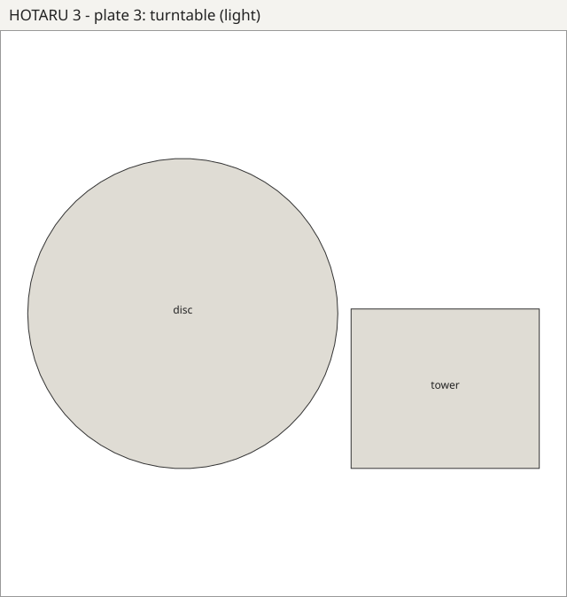
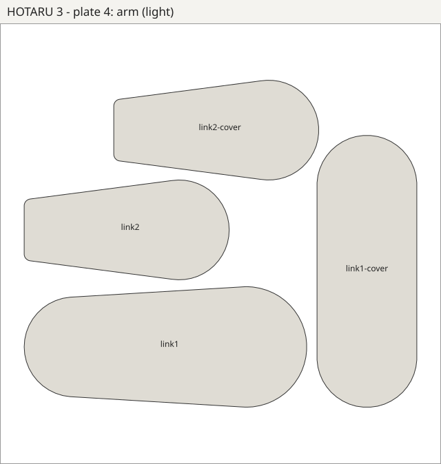
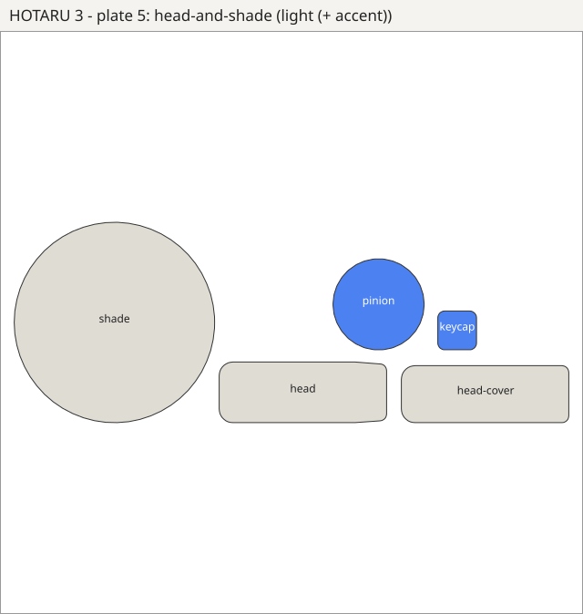

# HOTARU 3 — print plates for a Bambu P1S

## Just print it: [`HOTARU3-P1S-print-all.gcode.3mf`](HOTARU3-P1S-print-all.gcode.3mf)

One file, already sliced for a **P1S, 0.4 nozzle, Bambu PLA Basic, Textured
PEI plate**: all 18 parts on 4 plates, 19.8 h and 641 g in total. Open it in
Bambu Studio (or send it from Bambu Handy), print plate 1, clear the bed,
print plate 2, and so on. A P1S prints one plate at a time; the tub and the
lip ring are each 164 mm across, so no single 256 mm plate holds everything.

| plate | parts | time | PLA |
|---|---|---|---|
| 1 | shade, tower, link2, head cover, elbow pin, shoulder pin, keycap | 5.8 h | 193 g |
| 2 | link1, head, lip ring, link2 cover, LED clamp, head pin, shoulder pin | 5.3 h | 173 g |
| 3 | disc, link1 cover, pinion | 2.6 h | 86 g |
| 4 | tub | 6.1 h | 189 g |

The per-part settings below are built in. **Four parts get supports**, set
to "critical regions only" so the slicer supports just what would otherwise
print in mid-air: the tub (its slew-ring ledge juts 16.5 mm straight in from
the wall), link1, the head and the shade. Bambu Studio flags each of them as
a floating cantilever without supports. Every other part prints without.
[`HOTARU3-P1S-project.3mf`](HOTARU3-P1S-project.3mf) is the same thing
unsliced, to change filament, plate type or settings.

## The original five plates

Five plates, 256 × 256 bed. (These were published as needing no supports;
the slicer disagrees for the four parts above, so add supports to those if
you print from these.) Open a `.3mf` in
Bambu Studio or OrcaSlicer. Every part is its own object, already placed and
lying on the face it was designed to print on. The `.stl` of each plate is
the same layout as one mesh, for other slicers. `hotaru3-plates.zip` has all
of them.

| # | plate | filament | parts | layout size |
|---|---|---|---|---|
| 1 | [`plate-1-tub`](plate-1-tub.3mf) | main | tub | 164 × 164 × 53 |
| 2 | [`plate-2-lipring-and-pins`](plate-2-lipring-and-pins.3mf) | **dark** | lip ring, LED clamp, shoulder pin ×2, elbow pin, head pin | 246 × 164 × 14 |
| 3 | [`plate-3-turntable`](plate-3-turntable.3mf) | main | disc, tower | 231 × 140 × 66 |
| 4 | [`plate-4-arm`](plate-4-arm.3mf) | main | link1, link1 cover, link2, link2 cover | 228 × 190 × 63 |
| 5 | [`plate-5-head-and-shade`](plate-5-head-and-shade.3mf) | main + **accent** | shade, head, head cover, pinion, keycap | 244 × 88 × 101 |

Plate 2 holds every part the model colours dark, so it can run in a second
filament. On plate 5 the pinion and keycap are the blue accent parts: paint
them with the AMS, or print them separately if you want the colour.

| 1 tub | 2 lip ring + pins | 3 turntable |
|---|---|---|
|  |  |  |

| 4 arm | 5 head + shade |
|---|---|
|  |  |

## Settings

PLA, 0.4 nozzle, 0.2 mm layers, no supports.

| parts | walls | infill | why |
|---|---|---|---|
| link1, link2, tower, disc, pinion | 4 | 30 % gyroid | these carry the arm. The torque numbers assume ~75 % dense, which is roughly what 4 walls on 5 mm plates gives |
| journal pins (plate 2) | 4 | 100 % | they are the bearings |
| tub, lip ring, covers, head, shade, clamp, keycap | 3 | 15 % gyroid | |

* **Shade: add a 5 mm brim.** It prints mouth-down and only its 1.8 mm rim
  touches the bed.
* **Head:** the servo cavity's +X wall prints as a 20 mm bridge. Default
  bridge settings handle it.
* **Nut pockets are sized for a drop-in fit.** The six lip-ring nuts face
  downward in the tub's rim, so press those in before you turn the tub over.

## Before you print plate 3 or 4

Measure `HORN_TOP` (servo case top → horn face, horn pressed on). The design
assumes 9.0 mm and tolerates ±1 mm. See [`sw/README.md`](../../../sw/README.md).

Regenerate everything from the SolidWorks build:

```bash
python sw/h3_stl.py && python sw/h3_plates.py
```
