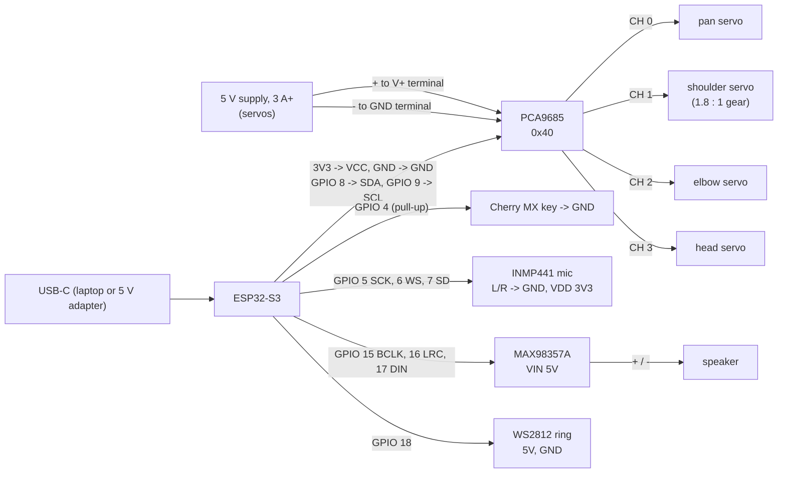

# HOTARU 3 firmware: the whole lamp

Hold the button, talk to it, and it answers out loud and acts the answer out.

```
mic (INMP441, 16 kHz) -> Deepgram nova-3 speech-to-text
  -> OpenRouter free model -> {"say", "action", "mood", "light", "volume"}
  -> the arm plays the action while Deepgram aura-2 speaks the words,
     streamed to the MAX98357A as they download
```

* **60 actions**: nod, shy, dance, peekaboo, sneeze, celebrate, sleep, spotlight,
  reading light, scan, think, sulk and more (type `list` on the serial monitor).
  Every key pose of every action passed the same pose guard and route planner as
  the motion core (holding torque under a third of stall, no part of the arm in
  the base, tower or button pod), inside the calibrated joint range. They are
  written by [`sw/h3_actions.py`](../../sw/h3_actions.py), which refuses to emit
  an action that fails.
* **The ring** (WS2812 x12) is the eye and the lamp: mood colours, a blue comet
  while listening, amber while thinking, pulsing with the voice while talking,
  warm white when asked to be a reading light.
* **Left alone** it fidgets now and then; after 10 minutes it folds up and dozes
  until the button is pressed.
* No libraries to install: Wire, Preferences, WiFi, HTTPClient and I2S ship with
  the ESP32 core, and the LED ring is driven straight off RMT.

## Wiring



| Part | Pin | Goes to |
|---|---|---|
| **PCA9685** | VCC | ESP32 **3V3** (logic only) |
| | GND | ESP32 GND |
| | SDA / SCL | GPIO 8 / GPIO 9 |
| | **V+ terminal** | **separate 5 V supply, 3 A or more** (+), with the 2200 µF across V+ and GND at the terminal |
| | GND terminal | the supply's (-), **and** joined to the ESP32 GND |
| | CH 0 / 1 / 2 / 3 | pan / shoulder / elbow / head servo: brown GND row, red V+, orange PWM |
| **Cherry MX** | one leg / other leg | GPIO 4 / GND |
| **INMP441** | SCK / WS / SD | GPIO 5 / GPIO 6 / GPIO 7 |
| | L/R | GND (left channel) |
| | VDD / GND | 3V3 / GND |
| **MAX98357A** | BCLK / LRC / DIN | GPIO 15 / GPIO 16 / GPIO 17 |
| | VIN / GND | 5V / GND |
| | SD, GAIN | leave open (on, 9 dB) |
| | + / - | speaker (bridged: never tie - to GND) |
| **WS2812 ring** | DIN | GPIO 18 |
| | 5V / GND | 5V / GND |

The same thing as a page with a schematic: [`docs/hotaru3-wiring.html`](../../docs/hotaru3-wiring.html).

**Power, the one thing that bites:** the servos must have their own 5 V supply on
the PCA9685's V+ terminal, its (-) on the V+ terminal's GND, joined to the ESP32's
GND. Nothing from that supply's (+) may touch the ESP32's 5V or 3V3 pins or the
PCA9685's VCC. On a laptop's USB alone, four MG996Rs starting up make the laptop
cut the port: the board drops off USB, or shows as "Unknown USB Device" and
reboots in a loop. **Hold the MX key while plugging in** to keep the servos off
(type `on` to engage them later).

## Setup

1. Copy `secrets.example.h` to `secrets.h` and fill in your Wi-Fi, a
   [Deepgram](https://deepgram.com) key and an [OpenRouter](https://openrouter.ai)
   key. `secrets.h` is in `.gitignore`.
2. Arduino IDE (or `arduino-cli`), ESP32 core 3.x, board **ESP32S3 Dev Module**:
   * Tools > PSRAM: **OPI PSRAM** (8 MB boards; recordings live there)
   * Tools > Partition Scheme: **Huge APP (3MB No OTA/1MB SPIFFS)**

   ```
   arduino-cli compile --fqbn "esp32:esp32:esp32s3:PSRAM=opi,PartitionScheme=huge_app" firmware/hotaru
   arduino-cli upload  -p COM5 --fqbn "esp32:esp32:esp32s3:PSRAM=opi,PartitionScheme=huge_app" firmware/hotaru
   ```
3. Park the arm at rest (folded, light on the desk) before power-up: the servos
   engage there one at a time, pan last, then it stretches awake and says hello.

## Calibration

Joints are calibrated in **servo degrees** (the 0..180 sweep), mapped to
500..2500 us. Per joint: `zero` = servo angle with the joint at 0 (arm straight
up, base facing front, head in line), `k` = servo degrees per joint degree (the
sign is the direction; 1.8 on the geared shoulder), and the servo-angle limits.

| joint | zero | k | min | max | joint range |
|---|---|---|---|---|---|
| pan | 90 | 1.0 | 0 | 180 | -90 .. 90 |
| shoulder | 0 | 1.8 | 0 | **125** (measured) | 0 .. 69 |
| elbow | 0 | 1.0 | 0 | **120** (measured) | 0 .. 120 |
| head | 90 | 1.0 | 15 | 165 | -75 .. 75 |

Change any of it on the lamp, no reflash:

```
servo head 90          raw servo angle (releases that joint) -- find the real centre
cal head zero 92       set it
j 3 40                 head +40 should tilt the light DOWN; if it goes up:
cal head k -1
cal save               keep it in flash ("cal reset" goes back to config.h)
```

The CAD's joint limits are never exceeded whatever the calibration says.

## Serial commands (115200)

| | |
|---|---|
| `<action>` / `list` | play an action / list all 60 |
| `ask <text>` | talk to it in text (skips the mic) |
| `say <text>` | speak, nothing else |
| `rec` | record 4 s and print what Deepgram heard |
| `p <pan> <sh> <el> <hd>` | move to a pose, joint degrees |
| `j <i> <deg>` | one joint (0 pan, 1 shoulder, 2 elbow, 3 head) |
| `g <pan> <sh> <el> <hd>` | ask the guard about a pose without moving |
| `stop` / `off` / `on` | stop / release all servos / engage |
| `v <x>` | speed scale (1 = normal) |
| `vol <0..1>`, `bright <0..255>` | speaker volume, eye brightness |
| `lamp on` / `lamp off`, `mood <name>` | reading light, ring colour |
| `cal`, `cal <i> zero\|min\|max\|k <v>`, `cal save`, `cal reset` | calibration |
| `servo <i> <deg>` | raw servo angle 0..180 |
| `wifi`, `forget` | Wi-Fi status, clear the conversation |

## Files

| file | |
|---|---|
| `hotaru.ino` | states (idle, listening, thinking, asleep), button, serial commands |
| `config.h` | pins, calibration defaults, speed caps, models, voice |
| `motion.h` | PCA9685, calibrated joints, pose guard, route planner, action player (own FreeRTOS task, 50 Hz) |
| `actions.h` | the 60 actions, **generated** by `sw/h3_actions.py` |
| `leds.h` | the ring: moods and effects, straight off RMT |
| `audio.h` | I2S mic into PSRAM, I2S speaker, the stream that plays speech as it downloads |
| `net.h` | Wi-Fi, a little JSON, Deepgram STT/TTS, OpenRouter |
| `brain.h` | personality prompt, conversation memory, reading the model's reply |
| `secrets.h` | your keys (not in git); `secrets.example.h` is the template |

Free OpenRouter models come and go: the list is at the top of `config.h`
(`OR_MODELS`), tried in order. Tested 2026-10-14: the two Nemotron models
answered in about a second.
